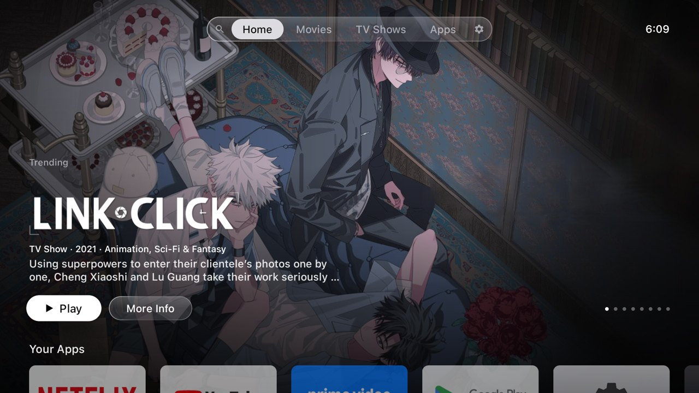
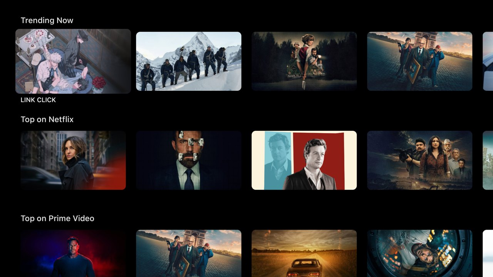
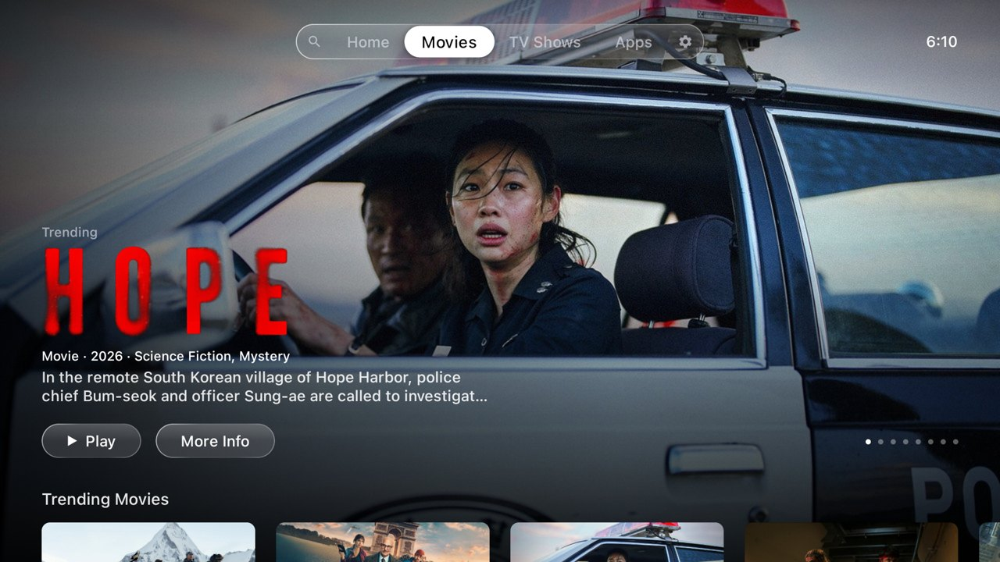
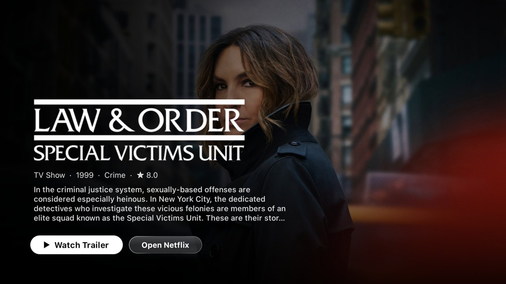
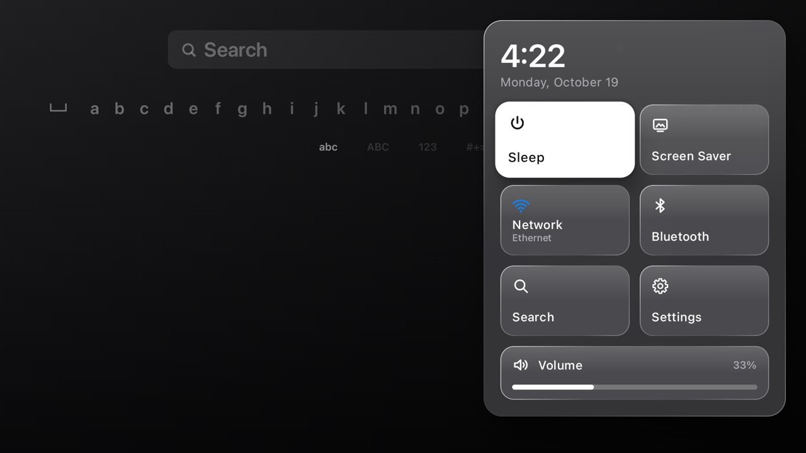
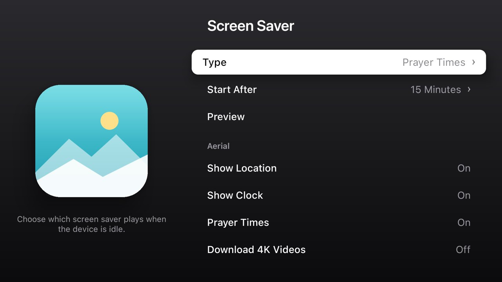

# tvhome — the Apple TV (tvOS) experience on an Android TV box

> 🇸🇦 النسخة العربية: [README.ar.md](README.ar.md)

**tvhome** replaces the launcher of an ordinary Android TV box with a full Apple TV–style system:
home screen, Top Shelf, Search, Settings, Control Center, App Switcher and Apple's Aerial
screensaver. A prayer-times screensaver for Baghdad is included as well. Everything is native
Kotlin + Jetpack Compose. It is designed against the official tvOS Human Interface Guidelines
and tuned to run smoothly on a cheap 2 GB Android 9 box.



| | |
|---|---|
|  |  |
|  |  |
|  |  |
|  |  |

> Not affiliated with, endorsed by, or connected to Apple Inc. "Apple TV", "tvOS" and "SF Pro" are
> trademarks of Apple Inc. This is a personal design study.

---

## 🤖 Rebuild it with AI: one copyable prompt

**[docs/MASTER-PROMPT.md](docs/MASTER-PROMPT.md)** is a single prompt you can copy (Arabic:
[MASTER-PROMPT.ar.md](docs/MASTER-PROMPT.ar.md)). Paste it into Claude Code, Cursor, Codex or a
similar tool and it builds this whole system phase by phase. Prefer smaller steps? Use
[docs/PROMPTS.md](docs/PROMPTS.md) ([العربية](docs/PROMPTS.ar.md)).

---

## Features

| Surface | What it does |
|---|---|
| **Home** | Floating Liquid Glass tab bar (Search · Home · Movies · TV Shows · Apps · Settings) with a sliding focus pill and a clock. Full-bleed hero carousel shows real TMDB content (title logo, metadata, **Play** / **More Info**). Below it: Your Apps, Trending Now, Top on Netflix, Top on Prime Video, Popular Movies, Popular TV Shows. |
| **Movies / TV Shows** | A hero plus trending, top-rated and genre rows. Selecting a card opens a product page. |
| **Apps** | tvOS-style 5-column app grid. Hold OK for jiggle mode to reorder; the action sheet offers Move / Hide / App Info / Uninstall. |
| **Search** | tvOS linear keyboard. Results include installed apps and TMDB movies & shows. The product page has a trailer button that opens YouTube. |
| **Settings** | tvOS Settings with app-icon tiles per section. Every row reads or writes real system state (display mode, network, screensaver, apps, language…). |
| **Control Center** | **Hold Home** from any app: clock, Sleep, Screen Saver, Network, Bluetooth, Search, Settings and a volume slider. |
| **App Switcher** | **Double-press Home**: recent apps as cards. Press Up on a card to close that app. |
| **Aerial screensaver** | Apple's own aerial videos (114 clips, streamed from Apple's servers) with location captions and a clock. |
| **Prayer Times screensaver** | Aerial video background with Baghdad prayer times (Shia/Jafari method), calculated offline. The next prayer is shown as the "focused" tile with a countdown and a progress bar. Also shows the clock, Gregorian + Hijri date, Baghdad weather and an Instagram follower counter. |

Design rules come from [`docs/HIG-tvOS.md`](docs/HIG-tvOS.md), a binding spec distilled from all
102 HIG pages that contain tvOS guidance. It covers safe areas, the tvOS type scale, grid sizes,
tab-bar metrics, focus states, parallax and Liquid Glass.

---

## Requirements

| Item | Version / note |
|---|---|
| Android TV device | Android 8.0+ (minSdk 26). Developed and tuned on a low-end Android 9 TV box with 2 GB RAM. |
| JDK | 21 (Android Studio's bundled JBR works) |
| Android SDK | Platform 36 + build-tools |
| `adb` | Platform-tools, on your `PATH` |
| TMDB account | Free API **Read Access Token** from <https://www.themoviedb.org/settings/api> |

---

## 1 · Build

```bash
git clone <this repo> tvhome && cd tvhome

# local.properties is git-ignored — create it:
cat > local.properties <<'EOF'
sdk.dir=/path/to/Android/sdk
TMDB_READ_TOKEN=eyJhbGciOi...your TMDB read token...
INSTAGRAM_HANDLE=yourhandle   # optional, for the prayer screensaver
EOF

export JAVA_HOME="/Applications/Android Studio.app/Contents/jbr/Contents/Home"   # JDK 21
./gradlew :app:testReleaseUnitTest :app:assembleRelease
# → app/build/outputs/apk/release/app-release.apk
```

**Always install the release build.** It is minified with R8 and signed with the debug key so
it installs directly. A debuggable Compose build is visibly slower on low-end TV hardware.

---

## 2 · Install on the TV box

Enable **Developer options → USB/Network debugging** on the box, then:

```bash
adb connect <box-ip>:5555          # or plug in USB
adb install -r app/build/outputs/apk/release/app-release.apk
```

### Make it the Home screen

```bash
adb shell cmd package set-home-activity com.hamad.tvhome/.MainActivity
# The stock Google TV launcher outranks third-party launchers — disable it (reversible):
adb shell pm disable-user --user 0 com.google.android.tvlauncher
adb shell input keyevent KEYCODE_HOME
```

### Enable Control Center + App Switcher (system-wide)

These run as an accessibility service in their own process, so they work over any app.

```bash
adb shell settings put secure enabled_accessibility_services \
  com.hamad.tvhome/com.hamad.tvhome.system.SystemUiService
adb shell settings put secure accessibility_enabled 1
adb shell appops set com.hamad.tvhome GET_USAGE_STATS allow      # recent apps for the switcher
```

### Permissions for Settings (so it can change things directly)

```bash
adb shell pm grant com.hamad.tvhome android.permission.WRITE_SECURE_SETTINGS
adb shell appops set com.hamad.tvhome WRITE_SETTINGS allow
```

### Choose the screensaver

```bash
# Prayer Times dashboard (over Aerial video):
adb shell settings put secure screensaver_components \
  com.hamad.tvhome/com.hamad.tvhome.dashboard.PrayerDashboardDream
# …or plain Aerial:
# com.hamad.tvhome/com.hamad.tvhome.aerial.AerialDreamService
adb shell settings put secure screensaver_enabled 1

# Preview it now:
adb shell am start -n com.android.systemui/.Somnambulator
```

You can also pick the screensaver, its start delay and its options inside **Settings → Screen Saver**.

### Optional: keep the clock correct after power cuts

Boxes without an RTC battery boot at their factory date. With encrypted Private DNS enabled,
that wrong date breaks DNS, so the clock can never sync. Point NTP at an IP address:

```bash
adb shell settings put global ntp_server 162.159.200.123   # time.cloudflare.com
```

---

## 3 · Remote control map

| Button | Action |
|---|---|
| D-pad | Move focus |
| OK | Open / select |
| Hold OK | Jiggle mode (reorder apps) / more options |
| Back | Go up one level; on the Home tab bar it does nothing |
| Home | Back to the Home tab |
| Hold Home | Control Center |
| Double-press Home | App Switcher |
| Menu / Play-Pause | Action sheet for the focused app |

---

## 4 · Configuration

| What | Where |
|---|---|
| TMDB token | `local.properties` → `TMDB_READ_TOKEN`, exposed to code as `BuildConfig.TMDB_READ_TOKEN` |
| Content region (Netflix/Prime rows) | Settings → Home Screen → Top Shelf Region, stored in `prefs/LauncherPrefs.kt` |
| Prayer city & method | `prayer/PrayerTimes.kt` → `PrayerConfig.BaghdadJafari` (lat/lon, UTC offset, Fajr/Isha/Maghrib angles) |
| Weather cities | `dashboard/DashboardData.kt` → `CITIES` (Open-Meteo, no key) |
| Instagram account | `local.properties` → `INSTAGRAM_HANDLE=yourhandle` (blank = hidden) |
| Hidden apps, click sounds, screensaver options | Settings app (stored in `LauncherPrefs`) |

---

## 5 · Project structure

```
app/src/main/java/com/hamad/tvhome/
├── design/      tvOS design kit: TvType (HIG type scale), TvColors, TvDims, LiquidGlass, TvButton/TvRow
├── ui/ home/    Home screen: tab bar, hero carousel, rows, app grid, focus motion, content repository
├── search/      Search app: linear keyboard, results, product page
├── settings/    Settings app: pages, icon tiles, system info readers
├── system/      Accessibility service: Home-key router, Control Center, App Switcher overlays
├── aerial/      Aerial screensaver: Apple catalogue (.tar/plist), ExoPlayer playback, TLS for Apple's CA
├── dashboard/   Prayer-times screensaver: layout, weather + Instagram data, Arabic formatting
├── prayer/      Offline prayer-time astronomy (PrayTimes algorithm) + schedule logic
├── tmdb/        TMDB v3 client (trending, providers, search, details, title logos)
├── prefs/       LauncherPrefs (shared settings, StateFlow)
└── AppRepository, OrderStore, GridNav, MainActivity, HomeViewModel
docs/HIG-tvOS.md   the binding design spec
AGENTS.md          instructions for AI coding agents (also AGENTS.ar.md)
docs/PROMPTS.md    the prompt playbook to rebuild this with an LLM (also PROMPTS.ar.md)
docs/MASTER-PROMPT.md  one complete copyable prompt for the whole system (also MASTER-PROMPT.ar.md)
```

---

## 6 · Data sources (real data only)

| Data | Source | Notes |
|---|---|---|
| Movies & shows | TMDB API v3 | Requires attribution: *This product uses the TMDB API but is not endorsed or certified by TMDB.* |
| Aerial videos | `sylvan.apple.com` (Apple's public tvOS feed) | Streamed, never redistributed. Apple's root CA is bundled for that host only. |
| Prayer times | Computed on-device | PrayTimes algorithm, Jafari angles (Fajr 16°, Maghrib 4°, Isha 14°). Unit-tested against Aladhan to within 1 minute. |
| Weather | Open-Meteo | Free, no key |
| Instagram followers | Public profile page | Logged-out Instagram only exposes the rounded figure (e.g. "14K"). The exact count needs the official Instagram Graph API. |
| Hijri date / Ramadan | ICU `IslamicCalendar` (Umm al-Qura) | |

When a source fails, the UI hides that element. It never shows invented numbers.

---

## 7 · Performance (measured on a 2 GB Android 9 box)

| Metric | Result |
|---|---|
| Home at rest | **0 frames** rendered, 0 % CPU (no idle animations at all) |
| Row navigation | ~2 % janky frames, p90 13–16 ms |
| Tab switch | worst frame 24 ms. Pages are kept composed and prefetched; the focus pill slides. |
| Prayer screensaver | redraws once a minute |

How: graphicsLayer-only animations, ≤ 2 full-screen layers, pre-baked hero scrims, size-capped
image decoding, and the accessibility service in its own process (`:system`), so key filtering
never waits on the UI thread.

---

## 8 · Tests

```bash
./gradlew :app:testReleaseUnitTest
```

The 64 unit tests cover grid navigation, row scrolling, prayer-time astronomy (vs Aladhan),
prayer schedule, Arabic plural/number formatting, the Home-key router, recents ordering and Aerial
catalogue parsing.

---

## 9 · Uninstall / restore the stock launcher

```bash
adb shell pm enable com.google.android.tvlauncher
adb shell settings put secure enabled_accessibility_services ""
adb uninstall com.hamad.tvhome
# packages removed with "pm uninstall --user 0 <pkg>" come back with:
adb shell cmd package install-existing <pkg>
```

---

## 10 · Troubleshooting

| Symptom | Fix |
|---|---|
| Hold Home / double Home stopped working after an update | `adb install -r` and `am force-stop` both unbind the accessibility service. Re-run the two `settings put secure …` commands; if it still doesn't bind, `adb reboot`. |
| Screenshots of the screensaver show black video | Normal: Many TV boxes render video on a hardware plane that `screencap` can't see. Check on the TV, or use an emulator. |
| `adb shell input keyevent` doesn't trigger Control Center | Injected keys bypass the accessibility key filter. Use the real remote (or `uinput` on an emulator). |
| Clock shows 2017 after a power cut | See "keep the clock correct" above. |
| Prayer card / dashboard hidden | The card hides itself while the system clock is unset (year < 2025), so it never shows wrong times. |

---

## ⚠️ Before you publish this repo

- **SF Pro / SF Arabic fonts** (`app/src/main/res/font/sf_*`) are Apple-licensed for Apple
  platforms only. Remove them from any public fork and swap in an open font (e.g. Inter / IBM Plex
  Sans Arabic) by changing `design/Tv.kt → TvFonts`.
- `local.properties` holds your TMDB token and is git-ignored. Keep it that way.

## License

Personal project; no license granted yet. Add one before publishing.

---
Based on [hamdalaa/tvhome](https://github.com/hamdalaa/tvhome). Build with your own free TMDB token (see Settings > Secrets > TMDB_READ_TOKEN, then Actions > build).
